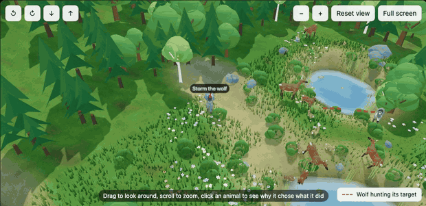
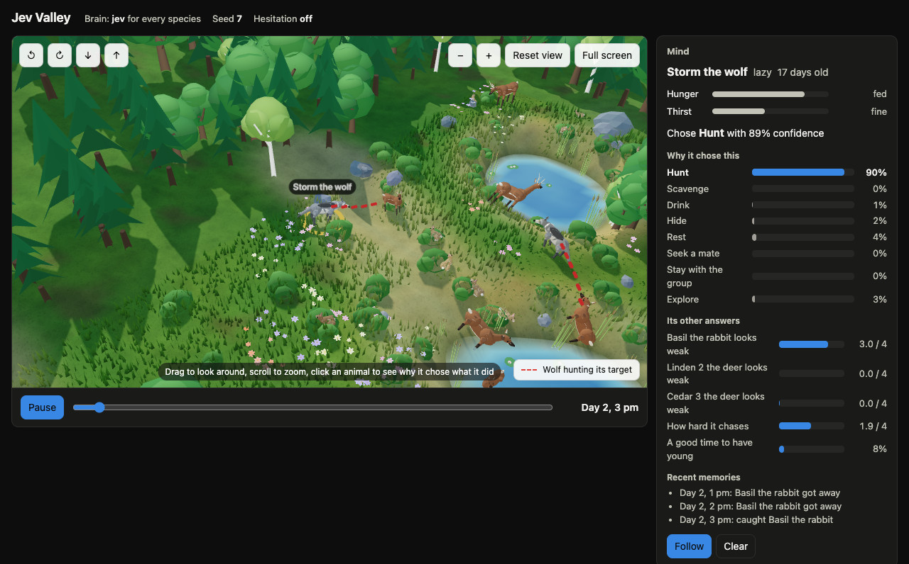

# Jev Valley

A small simulated valley where every rabbit, deer and wolf decides its next action by asking a typed decision model a `Choice` question and a few `Score` and yes/no (`Noul`) questions, once per valley hour. Nothing in the valley is scripted: the model decides what each animal does, and ordinary code decides how it happens.



*Five seconds of a real run (seed 7, decided by Jev). Storm the wolf is hunting; the red dashed line joins a wolf that chose to hunt to its target.*

Jump to: [Quick start](#quick-start) · [What you will see](#what-you-will-see) · [Commands](#commands) · [Troubleshooting](#troubleshooting) · [Results so far](#results-so-far) · [Documentation](#documentation)

## Quick start

You need Python 3.11 or newer, an API key for Jev, and a current browser (Chrome, Edge, Firefox or Safari) with WebGL. The commands below are for macOS and Linux; Windows should work but has not been tried.

**1. Get the code and install it.**

```bash
git clone https://github.com/Sarthak8696/jev-valley.git
cd jev-valley
python3 -m venv .venv
source .venv/bin/activate          # Windows: .venv\Scripts\activate
pip install -e ".[dev,charts]"
```

The valley itself uses only the Python standard library. The `dev` extra adds `pytest` for the tests, and `charts` adds `matplotlib`, which only the benchmark charts need. Check that it worked with `python -m valley --version`.

**2. Give it your Jev key.**

```bash
export TYPESAFE_API_KEY=your-key-here     # Windows PowerShell: $env:TYPESAFE_API_KEY = "your-key-here"
```

The key is read from the environment, in the same terminal you run the next command from. It is never written to a file or a log. Without it nothing runs: the valley has no offline mode, and stops at once with `error: TYPESAFE_API_KEY is not set`.

**3. Watch a two-day valley, live.**

```bash
python -m valley live --seed 7 --days 2 --open
```

The terminal prints `Jev Valley live at http://127.0.0.1:8765` and `Waiting for a viewer to connect before the valley starts.`, and your browser opens that page. (If it does not open, paste the address into a browser yourself.) The valley starts when the page is open and plays one valley hour per real second, so two days take about a minute and use roughly 2 million input tokens, about $0.10 at the documented price of $0.042 per million (an estimate: check your own usage). When the run ends, the timeline slider appears and the run is saved to `runs/live-jev-seed7/`. Leave `--days` out for a full month of 30 days, which takes 12 minutes or more.

**4. Watch it again later, with no key and no cost.**

```bash
python -m valley view runs/live-jev-seed7/replay.json -o valley.html
open valley.html                   # Linux: xdg-open valley.html    Windows: start valley.html
```

A finished replay has the timeline slider from the start, so you can scrub through it.

That is all there is to running it. `run`, `bench` and `tune` have no window of their own; [Commands](#commands) says which command to use for what.

## What you will see



*Day 2, 3 pm of the same run. Click any animal and the Mind panel shows what it needs, what it chose and why. Storm, a lazy 17-day-old wolf, chose Hunt, and answered that Basil the rabbit looks 3.0 out of 4 on weakness and that the chase deserves 1.9 out of 4 effort. At 3 pm Storm caught Basil.*

- A 40 × 26 valley in 3D with a stream, ponds, woods and meadows. The sun, moon and stars follow the clock, and the animals walk, graze, hide, hunt and drink, moving smoothly across the turn of every hour.
- A **Mind** panel for the animal you click: its hunger and thirst, what it chose, the probability Jev gave to every action, its answers to the extra questions, and its recent memories.
- A population chart and an event log. Playback is always one valley hour per second, with no fast-forward. In live mode the timeline slider appears once the run has played to its end, so you cannot skip ahead of the model.

There is no offline mode: the valley does not run without a model. The [viewer guide](docs/viewer.md) has the controls, more screenshots and what pausing does.

## Commands

| You want to | Command | Key needed | Opens a window | Writes to |
|---|---|---|---|---|
| Watch a valley as the model decides it | `python -m valley live --seed 7 --open` | yes | **yes**, in your browser | `runs/live-jev-seed7/` |
| Run a valley without watching it | `python -m valley run --seed 7 --days 2` | yes | **no** | `runs/run-jev-seed7/` |
| Watch a finished run | `python -m valley view runs/<run>/replay.json -o valley.html`, then open `valley.html` | no | **yes**, once you open the file | `valley.html` |
| Compare conditions over several seeds | `python -m valley bench survival` | yes | **no** | `results/survival/` |
| Set the hesitation thresholds | `python -m valley tune --thresholds RUN_DIR [RUN_DIR ...]` | no | no | `results/hesitation/thresholds.json` |
| Run the tests (they run offline, with stand-ins for the model) | `python -m pytest` | no | no | nothing |

`run` and `bench` open nothing: they print progress, write files and finish. To see a valley, use `live`, or use `view` on the `replay.json` that `run` wrote. When `run` finishes it prints the exact `view` command to paste. A run folder holds `replay.json` (the whole run, for the viewer), `metrics.json` (survival, blunders, calibration, judgement and cost) and, if you asked for it, `requests.jsonl` (every request and response). `live` keeps the request log by default, roughly 100 MB for a month: add `--no-log-requests` to skip it.

All options, the cost of a run and the steps to reproduce the benchmark are in [docs/running.md](docs/running.md).

## Troubleshooting

| What you see | What to do |
|---|---|
| `error: TYPESAFE_API_KEY is not set. Export it before using the jev brain.` | Export the key in the same terminal you run the command from (step 2 of the quick start). |
| "I ran `run` or `bench` and no window opened" | They are not meant to. Use `live --open`, or `view` on the `replay.json` that `run` wrote. |
| The terminal says `Waiting for a viewer to connect` and nothing happens | The valley starts only when a page is open. Open the address it printed, `http://127.0.0.1:8765` unless you changed `--port`. |
| The run stopped with `error: the run stopped.` | Any failed call stops the run on purpose, so no animal is ever given a made-up decision. Check the key and your network, then run it again. |
| A flat map instead of 3D, or a blurry picture | Turn on your browser's hardware acceleration, reload, and add `?resolution=full` to the address to keep full resolution. |

More cases are in the [full troubleshooting table](docs/running.md#troubleshooting).

## The question

Does a typed decision model make sensible decisions, and does it know when it is wrong? Every run uses the same maps, the same seeds and the same starting animals; only the brain changes (Jev, or another model behind `system-one@URL#MODEL`). Three things are measured: whether the valley survives the month; how often a choice is a clear blunder, and whether the model's confidence predicts it; and how well its answers to the extra questions match what really happens (see [More than a choice](docs/how-it-works.md#more-than-a-choice)). A second question: does knowing when you are unsure help you survive? With hesitation on, an animal freezes for the hour when the model's confidence is low, and survival is compared with hesitation off.

## Results so far

The full benchmark against Jev has not been run yet, so there are no benchmark results to report. To reproduce them, see [docs/running.md](docs/running.md#reproduce-the-benchmark).

A first look comes from three single month-long runs on Jev (seeds 7, 11 and 21, on 2026-10-25). They are an early look, not a measurement.

| Seed | Rabbits (24 at the start) | Deer (10) | Wolves (5) | All three alive at the end |
|---|---|---|---|---|
| 7 | 45 | 6 | 2 | yes |
| 11 | 19 | 1 | 0 (the last wolf died on day 27) | no |
| 21 | 25 | 0 (the last deer died on day 19) | 4 | no |

- **The valley is not balanced for Jev yet.** Deer and wolves can die out, largely because wolves keep chasing deer they rarely catch (9% of chases, against 43% for rabbits). The valley has not been retuned for Jev.
- **The animals do try to survive.** Hungry animals eat, thirsty ones drink and prey flee wolves that are close. The ones that starved died trying.
- **Personality changes effort a great deal.** Lazy animals rest far more, and lazy wolves starved least.

The details, with the numbers behind each point, are in [docs/first-look.md](docs/first-look.md).

## Limitations

- Model answers vary between runs, so one run is not a measurement. The benchmark reports its seeds together (five by default, ten with `--seeds`), and five seeds give noisier medians than ten.
- The blunder rules are a simple, hand-written measure of what is clearly a bad choice, so they are a rough guide, not a verdict.
- Results apply to this valley and these prompts, not to the models in general.
- The balance of the valley was tuned with offline stand-ins that are no longer in the repo. With Jev, three month-long runs kept all three species alive in only one (see [Results so far](#results-so-far)): deer and wolves can die out, largely because wolves keep chasing deer they rarely catch. The valley has not been retuned for Jev. The game's numbers are scaled for play, not taken from field data, and the sources in [docs/ecosystem.md](docs/ecosystem.md) are the only research behind them.
- Personality changes how hard an animal tries, so which personality an animal is dealt can change its odds. It was seen on 24 wolves only.
- The Jev client was first written against a fake server built from the documented request and response shape, and has since been checked against the live API: one-day runs and three month-long runs on 2026-10-25, with the model `jev-1.14.0`. A later model version may answer differently.

## Documentation

| Read | For |
|---|---|
| [docs/running.md](docs/running.md) | Every command and option, what a run costs, how to reproduce the benchmark, and the full troubleshooting table |
| [docs/viewer.md](docs/viewer.md) | The controls, more screenshots, what pausing does and the page options |
| [docs/how-it-works.md](docs/how-it-works.md) | A real request and response, the extra questions and the design decisions |
| [docs/first-look.md](docs/first-look.md) | Three month-long runs on Jev, in detail |
| [docs/ecosystem.md](docs/ecosystem.md) | Why the valley is balanced the way it is, with sources |
| [docs/build-spec.md](docs/build-spec.md) | The full specification and the log of every decision made while building it |

## How this was built

This project was built with AI assistance (Claude). The code, tests and viewer were written by the assistant from a written build specification, and every choice the specification left open is recorded in [docs/build-spec.md](docs/build-spec.md).

## License

MIT. See [LICENSE](LICENSE).
