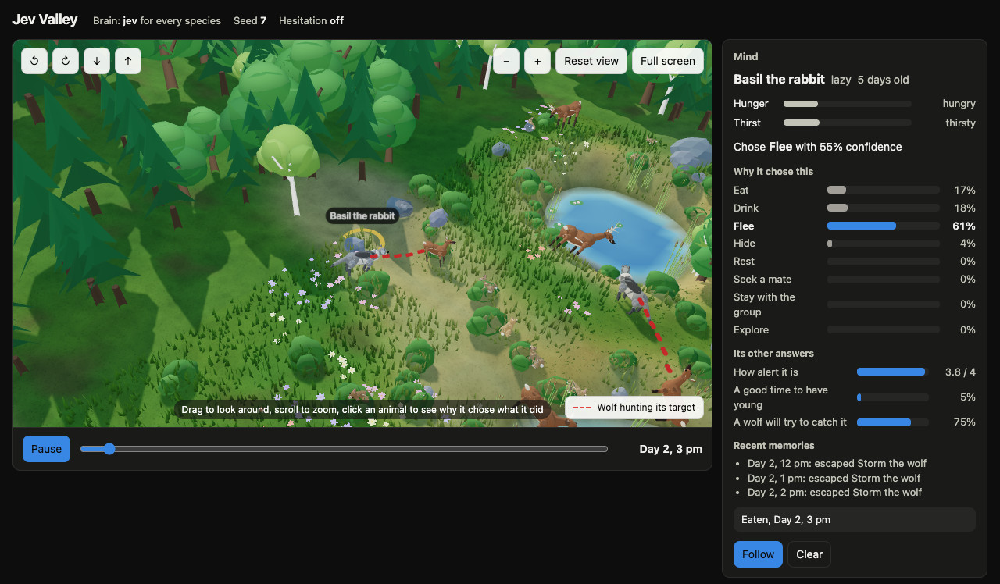
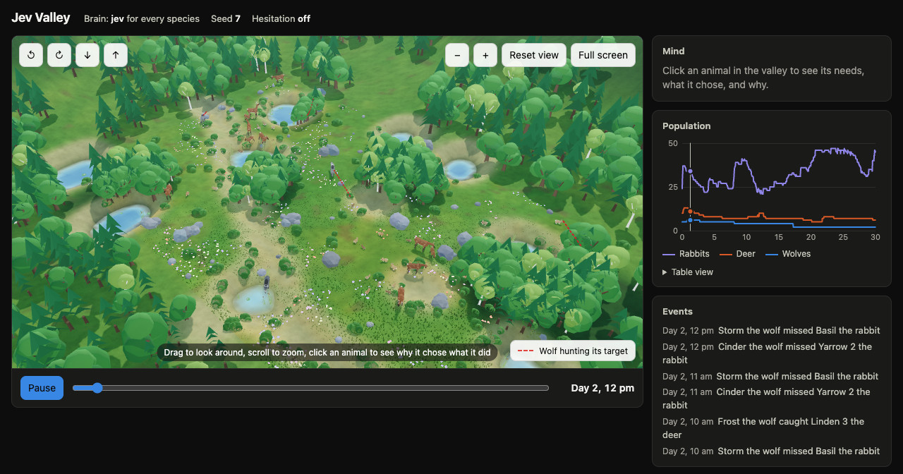
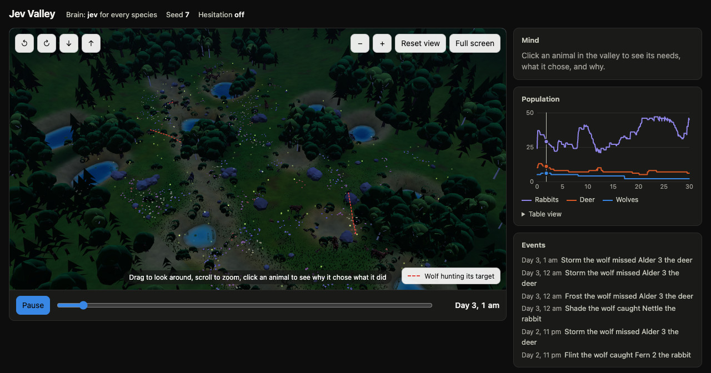

# The 3D viewer

What the viewer shows, how to move around in it, and its page options. To open it, see the [quick start in the README](../README.md#quick-start).

*Day 2, 3 pm of the same run. Click any animal and the Mind panel shows what it needs, what it chose and why. Storm, a lazy 17-day-old wolf, chose Hunt (the model's own confidence was 89%; the bars are the probability of each action). Its other answers: Basil the rabbit looks 3.0 out of 4 on weakness, the chase deserves 1.9 out of 4 effort, and it is not a good time to have young. At 3 pm Storm caught Basil.*

*The same hour, from the prey's side. Basil, hungry and thirsty, chose Flee, scored its alertness 3.8 out of 4, and put the chance that a wolf would go after it at 75%. It had escaped Storm three times already.*

- A 40 × 26 valley in 3D: a stream with fords, ponds, woods, meadows with wild flowers, and wooded hills around it. The sun, moon and stars follow the clock, and grass goes bare where animals have grazed. Rabbits, deer and wolves walk, trot, hop, graze, lie down, hide, hunt and drink, and keep moving smoothly across the turn of every hour.
- A **Mind** panel for the animal you click: its hunger and thirst, what it chose this hour and how sure the model was, the probability it gave to every action ("Why it chose this"), its answers to the extra questions, and its recent memories. The model's confidence is its own estimate, so it is not always the same number as the probability of the action it chose.
- A status line in live mode that shows the pace and the real usage so far, for example `Live: 1.0 hours per second · 214 model requests, 85,310 input tokens`. If the model is slow, the valley's clock slows down and the badge pulses while it waits. Decisions are never skipped or guessed.
- A red dashed line from a wolf that chose to hunt to its target. A legend in the corner of the view explains it, and clicking the legend hides the lines.
- A population chart and an event log. Playback is always one valley hour per second, with no fast-forward. The timeline slider appears once a live run has played to its end, so you cannot skip ahead of it; a finished replay has it from the start.

## Controls

| Control | What it does |
|---|---|
| Drag, or Q and E | Turn the view |
| Scroll, pinch, or + and − | Zoom |
| Right-drag, or two fingers | Slide the view |
| `0` or **Reset view** | See the whole valley again |
| Click an animal | Open its Mind panel; **Follow** keeps the camera on it; Esc clears the selection |
| Space | Play or pause. In live mode, pausing freezes the valley: no new decisions are asked while paused |
| ← and → | Step one hour back or forward, once the timeline is available |
| `F` or **Full screen** | Full screen; Esc leaves it |

## No offline mode, and what pausing does

**The valley does not run without a model.** `run` and `live` accept only Jev (or another server that speaks the same request format), and stop at once if the key is missing or a call fails. There is no offline mode and no hand-written stand-in inside the valley. Earlier versions had two comparison brains, `rules` and `random`; the last commit that has them is `4d545ed`.

The page tells the server where its playhead is and whether it is paused. While it is paused, or more than three hours ahead of what is on screen, no new hour is started and nothing is asked of Jev; the hour already in flight finishes. Closing the page ends the run after a few seconds and saves what was decided. The valley does not start until a page is open, so no model calls are spent unseen.

The screenshots here and the clip in the README come from one real month-long run on Jev (seed 7), played back in the viewer; there is no bundled demo, so every run you watch is one you make.

## Page options

The viewer is one HTML file, `viewer/index.html`. It loads Three.js, and its sky add-on, from a CDN, so it needs a network connection; everything else in it, the land, water, plants and animals, is drawn in code and nothing is downloaded. It lowers its own resolution when a device cannot keep up. Add `?quality=low` to the page address for a lighter version, or `?resolution=full` to keep the full resolution whatever the speed. `?webgl=off` shows the flat map. You can also open `viewer/index.html` yourself and drop a `replay.json` on it.
